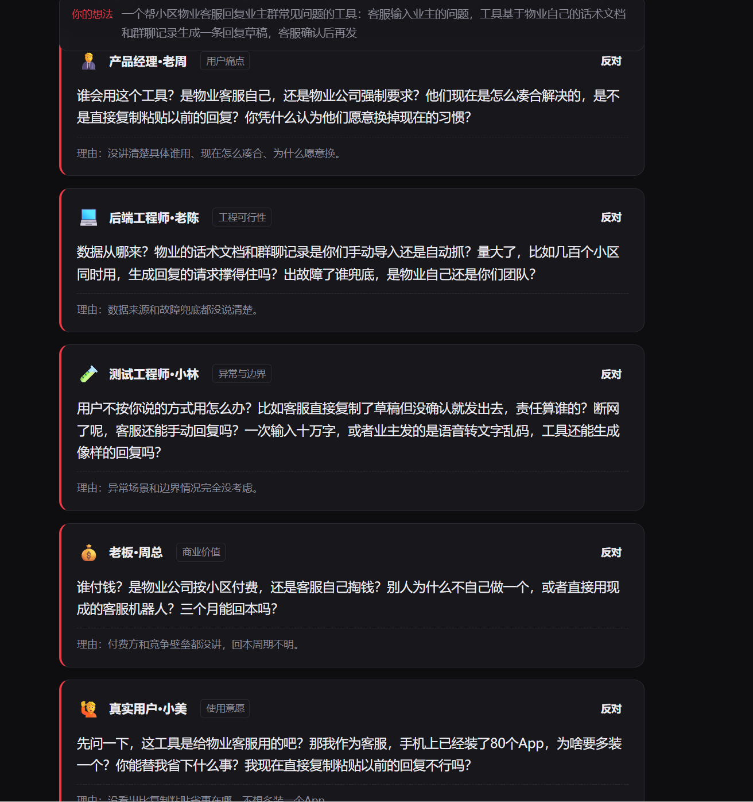
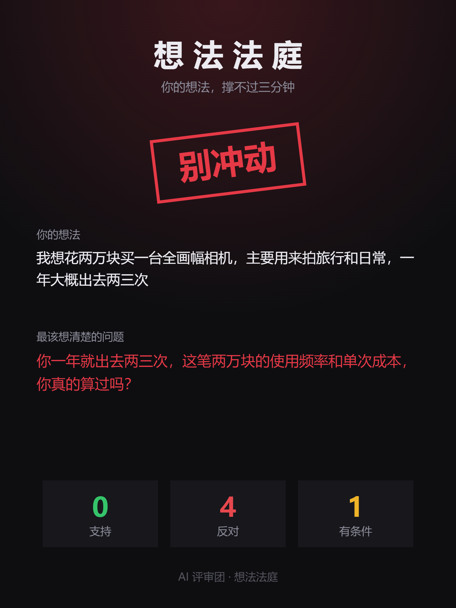
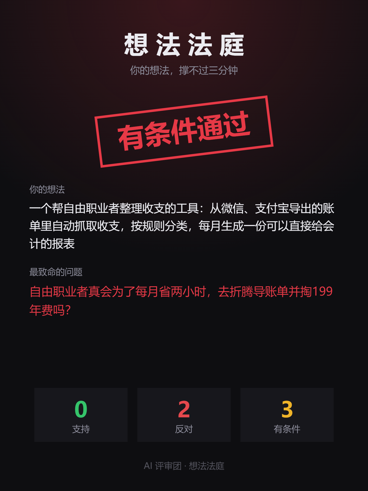
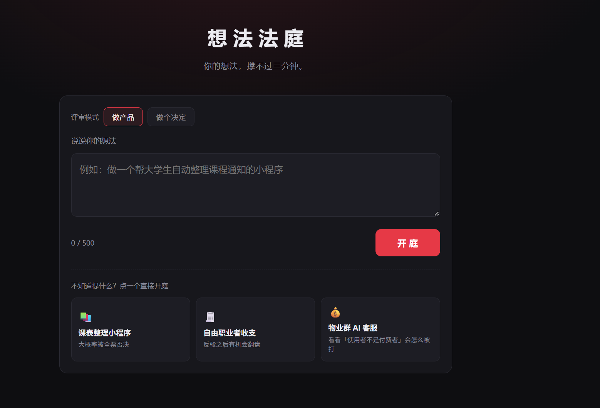

# AI 应用开发实习生 · 笔试题提交

## 一、作品信息

| 项目 | 内容 |
|---|---|
| 作品名称 | 想法法庭 / Idea Court |
| 一句话 | 一个 AI 分饰五个角色，围攻你的想法，你可以当场反驳。 |
| 项目类型 | 本地 Web 应用（FastAPI + LangGraph + DeepSeek） |
| 仓库地址 | https://github.com/DaXiGuaS/Idea-Court |
| 运行方式 | 见下方「快速开始」或 [README.md](README.md) |

---

## 二、作品简介

每个做过项目的人都听过这三句话：「这解决谁的痛？」「能变现吗？」「我怎么没见过类似的？」——但很少有人在写第一行代码之前认真回答过。

《想法法庭》把你的想法丢进一间 AI 评审室：**一个 AI 分饰五个角色**，产品经理只问痛点，后端只问可行性，测试只问异常，老板只问变现，真实用户只说「我为什么要装它」。你可以当场反驳，票数会重新统计。三分钟后，你会收到一份带表决票数的判决书。

它不只会审「做产品」。切到「做个决定」模式，评审团换成精算师、风险官、情绪观察员、过来人、反方，用来劝退「我想买一台两万的相机」这类决定。

它不只是骂你，而是逼你把没想清楚的地方想清楚。

---

## 三、效果展示

### 1. 五个人一起怼你



### 2. 它也能审「要不要买」



### 3. 反驳之后，票数会真的变



### 4. 打开就能玩，不用自己想案例



---

## 四、创作说明（283 字）

为什么选这个题：每个做过项目的人都听过"这解决谁的痛""能变现吗"，但没人认真回答。我想把它做成能玩的。

看点：一个 AI 分饰五个角色，各管一个维度互相拆台；你能当场反驳，票数会真的变。被驳回不可怕，被戳中才有价值。

用了哪些 AI 工具、踩了什么坑：Claude Code 写代码，DeepSeek 当评审。坑一是五个角色一开始全说"这没意思"，限定每人只问一个维度才分开；坑二是 function calling 不稳定，改用 JSON 模式加校验。

标题与平台：小红书《我的想法只活了 2 分 47 秒》，B 站《一个 AI 分饰五角，围攻你的 idea》。选小红书，因为"被否定"人人有共鸣，截图容易传播。

---

## 五、展示内容（图文教程）

完整图文教程见 [图文教程.md](图文教程.md)（约 1300 字，含 4 张配图）。

---

## 六、快速开始

```bash
cd idea-court
python -m venv .venv
.venv\Scripts\activate        # Windows
pip install -r requirements.txt
cp .env.example .env           # 填入 DeepSeek API Key
uvicorn main:app --reload
```

浏览器打开 <http://127.0.0.1:8000>

---

## 七、文件清单

| 文件 | 说明 |
|---|---|
| `main.py` | FastAPI 接口 |
| `graph.py` | LangGraph 编排 + 票数统计 |
| `reviewer.py` | LLM 调用（JSON mode + 重试） |
| `prompts.py` | 两套评审角色设定 |
| `models.py` | 数据模型 |
| `config.py` | 配置读取 |
| `static/index.html` | 前端（原生 HTML/CSS/JS，无构建） |
| `README.md` | 运行说明 |
| `图文教程.md` | 展示内容（图文教程） |
| `创作说明.md` | 300 字创作说明 |
| `assets/` | 4 张展示截图 |

---

## 八、设计取舍（简要）

- **一个 AI 分饰五角，而不是五个 AI**：一次调用约 5–10 秒、1500 tokens；拆成五次只会更慢更贵，角色分离靠提示词而非调用次数。
- **用 JSON mode 而不是 structured output**：DeepSeek 的 function calling 触发不稳定，`response_format={"type":"json_object"}` 更可靠。
- **票数由程序统计**：大模型数数是弱项，它只负责发言和投票。
- **每个角色只问一个维度**：否则五个人会说出同一句"这没意思"。
